<div align="center">


# VMS V0 — Inventory Management, Open Source

**Inventory management that respects the people doing the work.**

A free, open-source, self-hosted inventory template for teams still
running stock on spreadsheets and paper: typed storerooms, scan-first
workflows, an append-only ledger, tool custody, sensor monitoring, and
an audit trail that never forgets.

[](https://creativecommons.org/licenses/by-nc-sa/4.0/)
[](https://github.com/esoken92/VMS-V0/actions/workflows/ci.yml)
[](https://nextjs.org/)
[](https://www.postgresql.org/)
[](https://www.typescriptlang.org/)
[](https://web.dev/progressive-web-apps/)

**[Live app — vms-v0.vercel.app](https://vms-v0.vercel.app)** ·
[Seed credentials](#seeded-accounts) ·
[Documentation](docs/ARCHITECTURE.md) ·
[Integrations](docs/INTEGRATIONS.md) ·
[Report an issue](https://github.com/esoken92/VMS-V0/issues)

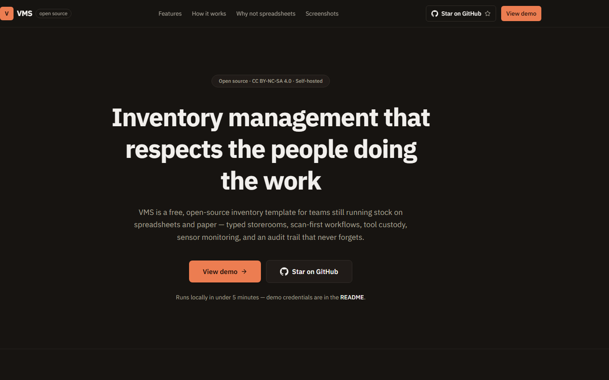

</div>

---

## Why this exists

~94% of audited spreadsheets contain errors. Paper records what you write
down — never what it doesn't see. Most small operations don't choose
between inventory systems; they choose between a system and a
spreadsheet, and the spreadsheet wins on price and familiarity while
losing on everything else: no audit trail, no alerts, invisible
shrinkage, month-ends that never reconcile.

VMS is the "actually do it properly" template — the same stock engine the
big systems use (append-only ledger, role-based permissions, scan-first
UX), packaged so a single `docker compose up` gets you a working system.
See the reasoning in [docs/LOGIC_CHAIN.md](docs/LOGIC_CHAIN.md) and the
research behind it in [docs/research/](docs/research/).

## Quickstart — under 5 minutes

**Option A — zero install (Node.js 20.9+ only, no Docker):**

```bash
cp .env.example .env          # set AUTH_SECRET (openssl rand -base64 32)
npm install
npm run dev:standalone        # → http://localhost:3000
```

`dev:standalone` uses an **embedded Postgres** (PGlite) stored in
`./.vms-data` — on first run it bootstraps the full schema and seed
dataset automatically, then starts Next.js. Nothing else to install.

How it works: one process owns the embedded postgres and serves it over a
localhost socket (`vms-owner.json` inside `.vms-data` is the claim file);
every Next dev worker — and plain `npm run dev`, `npm run db:bootstrap`,
`npm run db:seed` when `DATABASE_URL` is unset — attaches to it
automatically, so a single `npm run dev` also works with zero services.
Re-run `npm run db:bootstrap` to apply newly added migrations, and
`npm run db:reset` to wipe + rebuild the store (recovery for a corrupted
`.vms-data` — refuse while a dev server owns it).

**Option B — Docker Postgres (full parity):**

```bash
docker compose up -d        # Postgres 16 — schema auto-initialises
cp .env.example .env        # set AUTH_SECRET + DATABASE_URL
npm install && npm run dev  # → http://localhost:3000
```

`docker-compose.yml` mounts `supabase/migrations/` into the Postgres
container, so the schema builds itself on first boot. Load the seed
dataset (`npm run db:seed`) to sign in with the accounts below — it
seeds users, bin locations, suppliers, products, movements, tool loans,
and stock takes. With `DATABASE_URL` set, the app always uses the real
server (`lib/db/driver.ts` picks the driver); embedded mode is what runs
when it's unset.

> ⚠️ The seed creates **well-known public credentials**. Evaluation and local
> development only — never on data you care about.

## Seeded accounts

| Role            | Email                  | Password         |
|-----------------|------------------------|------------------|
| Super Admin     | `admin@vms-v0.local`   | `VmsAdmin123!`   |
| Manager         | `manager@vms-v0.local` | `VmsManager123!` |
| Fleet Dispatch  | `fleet@vms-v0.local`   | `VmsFleet123!`   |
| Warehouse Staff | `worker@vms-v0.local`  | `VmsWorker123!`  |

New sign-ups get the `staff` role; promote accounts from the Users page
as a super admin.

## Screenshots

| Landing | Sign in |
|---|---|
|  | 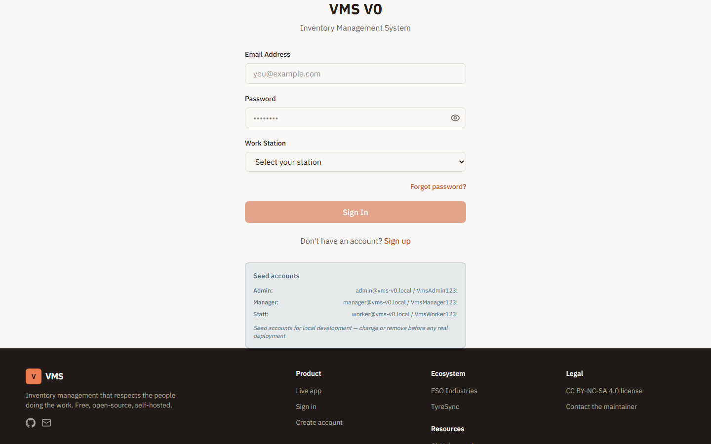 |

| Dashboard | Scan-first | Stock take |
|---|---|---|
| 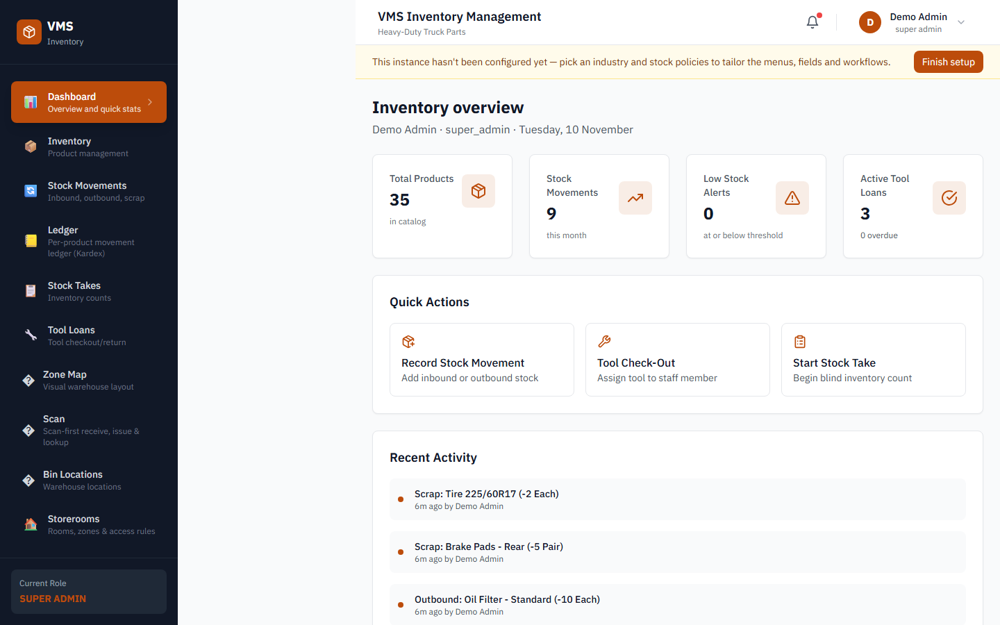 | 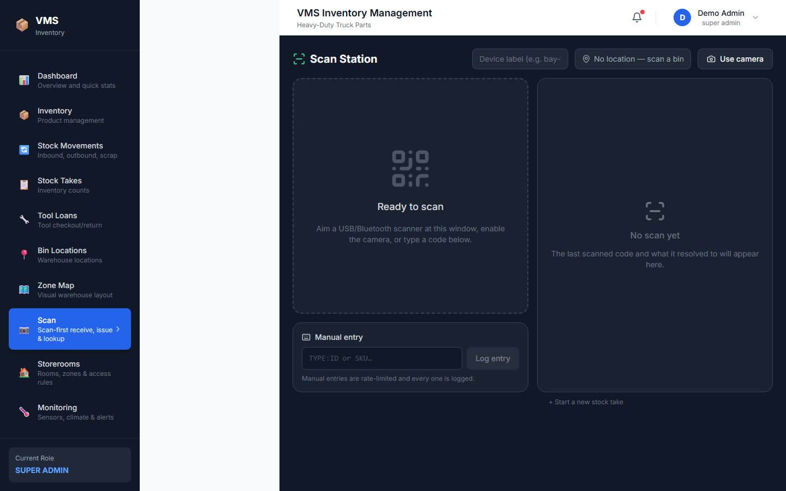 | 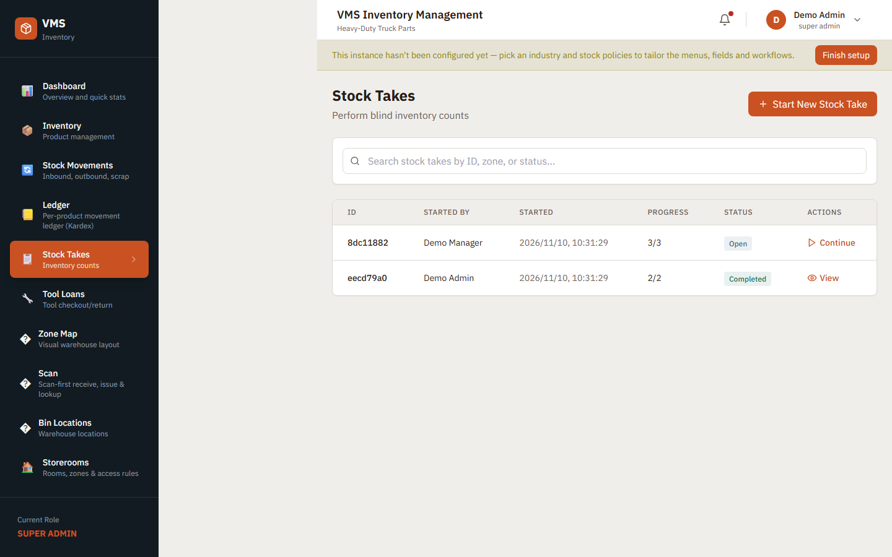 |
| Stat cards, alerts, activity feed — every number deep-links to where you act | Camera / wedge / RFID — one scan is one action | Blind counts, variance review, cycle counts |

| Storerooms | Monitoring | Reports |
|---|---|---|
| 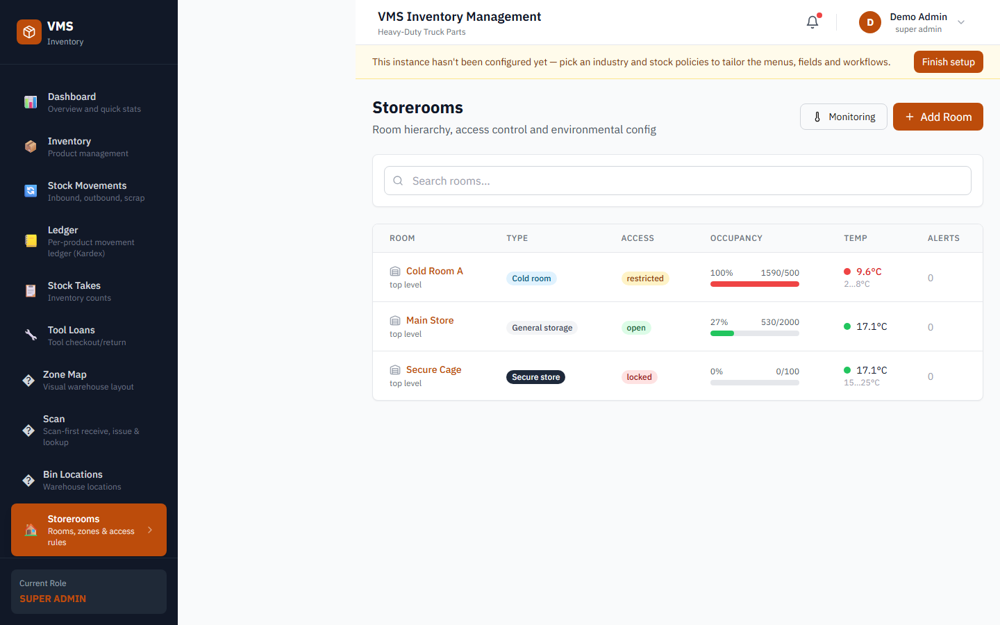 | 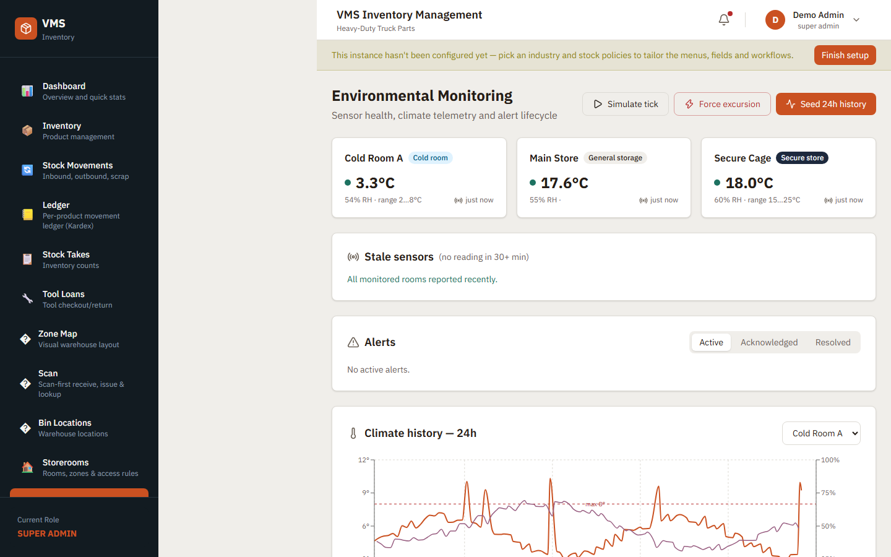 | 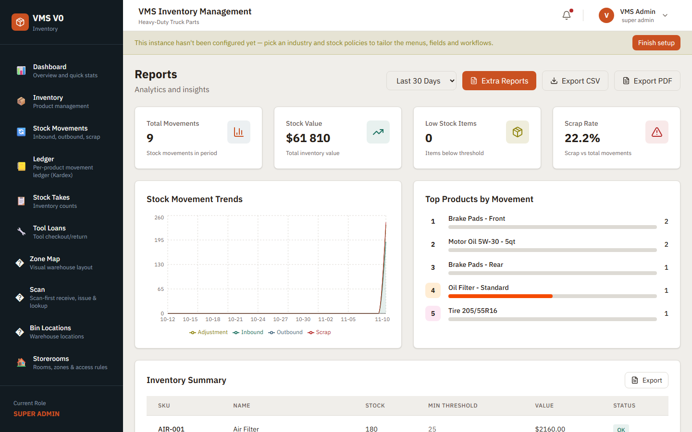 |
| Typed rooms — cold, secure, hazmat — with access levels and occupancy | Live temp/humidity telemetry, excursion alerts, sensor simulator | KPIs, movement trends, valuation, CSV export |

| Transfers | Report builder | API docs |
|---|---|---|
| 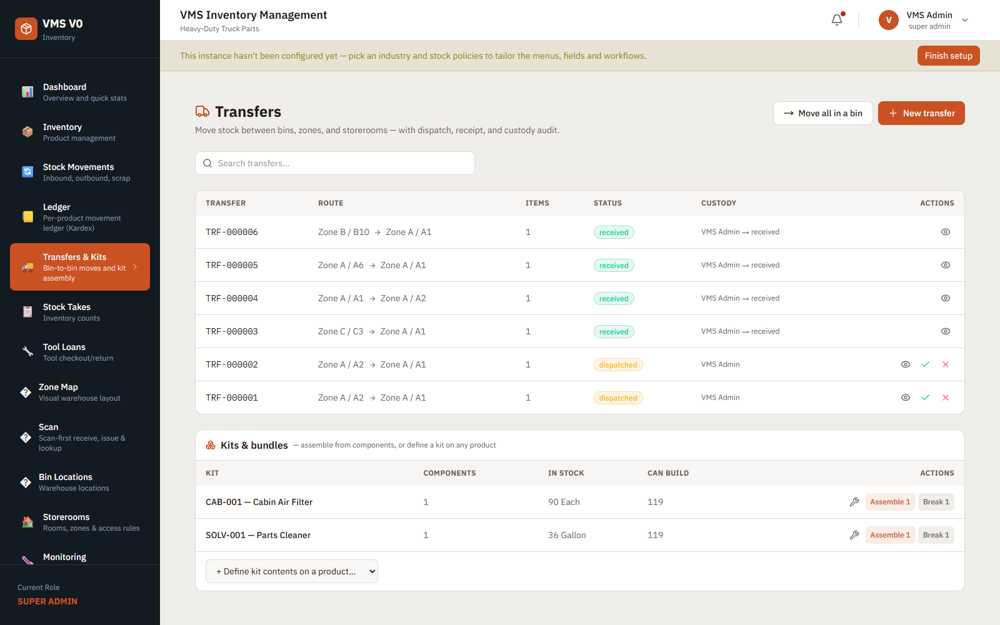 | 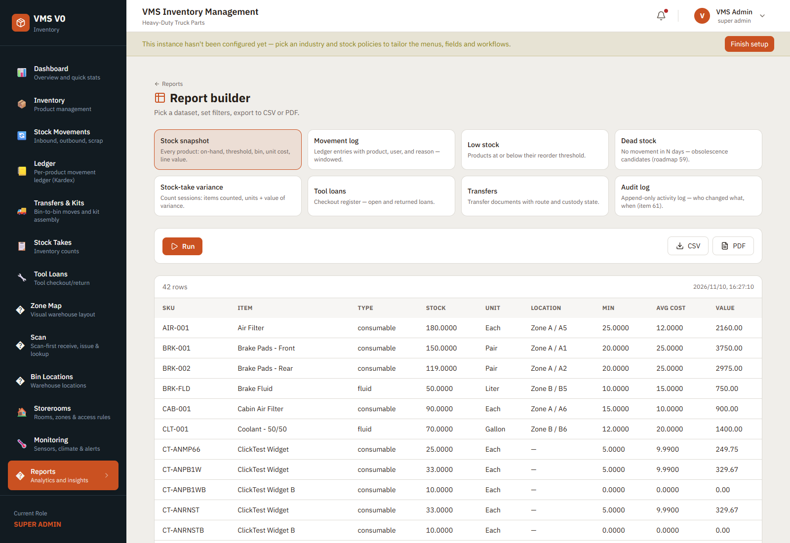 | 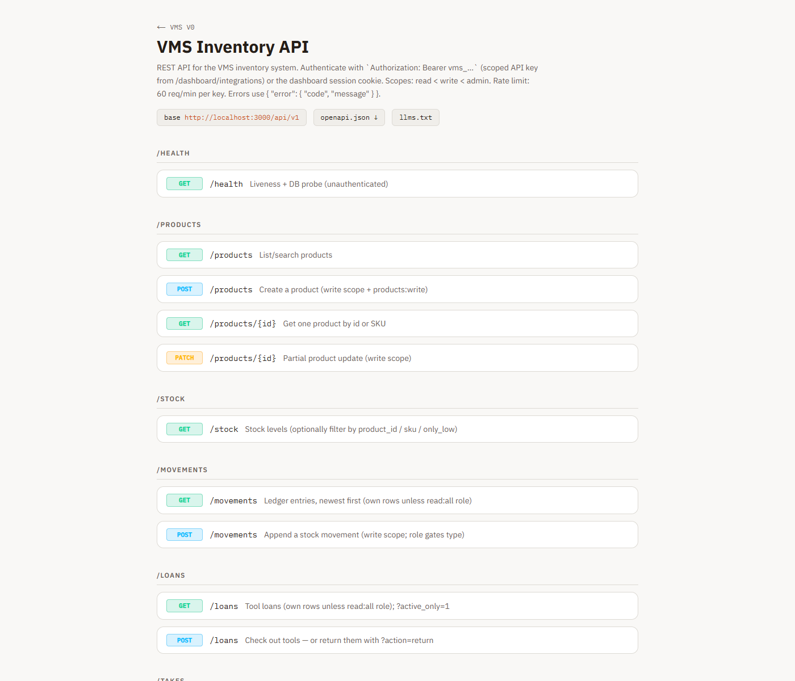 |
| Dispatch → in-transit → receive, with full custody chain | Eight datasets → table, CSV, or PDF in one screen | `/docs` — the live OpenAPI spec, rendered offline |

| Stock ledger (Kardex) | Integrations & MCP |
|---|---|
| 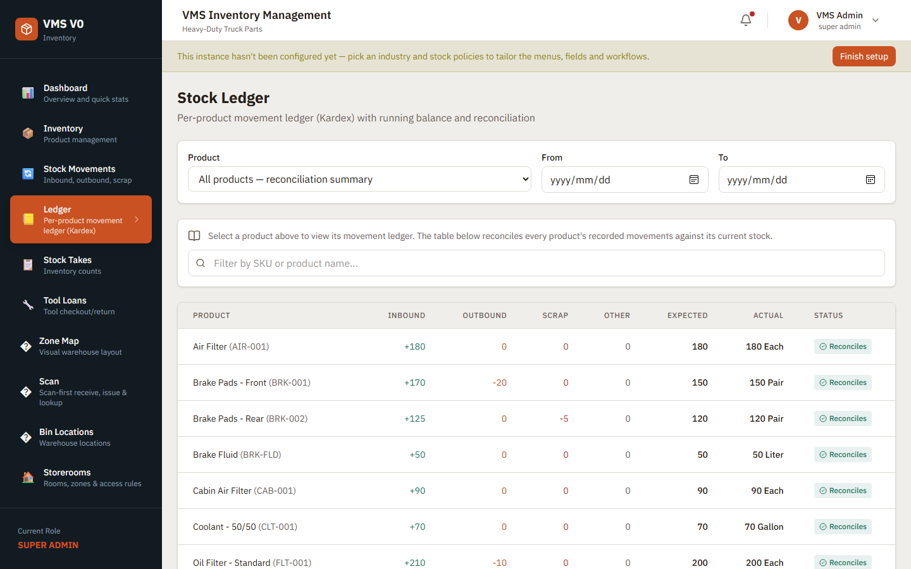 | 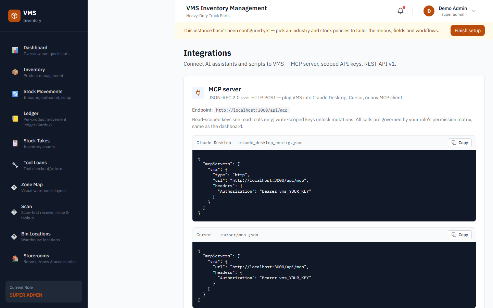 |
| Per-product running balance — every product reconciles: opening + movements = closing | Scoped API keys, REST v1 + OpenAPI, MCP tools for agents |

### Design tokens

Every color is a semantic token in
[`app/globals.css`](app/globals.css) — components never use raw palette
utilities. The palette is a custom five-color scheme (dusty lavender,
coral glow, canary, pale amber, air-force blue) mapped onto roles, with
color-blind-safe status pairs:

```css
/* app/globals.css */
:root {
  --primary: 17 72% 46%;      /* coral glow — buttons, links, CTAs      */
  --sidebar: 204 30% 10%;     /* air-force blue — fixed dark rail      */
  --success: 168 60% 28%;     /* Okabe-Ito bluish-green (CVD-safe)     */
  --warning: 55 78% 32%;      /* pale amber family                     */
  --info:    204 28% 40%;     /* air-force blue                        */
  --highlight: 60 92% 61%;    /* canary — markers only, never text     */
  --lavender: 324 24% 48%;    /* dusty lavender — secondary accent     */
}
/* Tailwind 4 @theme maps each channel var to a color utility */
```

```html
<!-- components consume tokens — no hex, no bg-blue-600, anywhere -->
<button class="bg-primary text-primary-foreground hover:bg-primary/90">
  Open the app
</button>
<span class="bg-success/10 text-success">In stock</span>
```

## Features

- **Storerooms by type** — cold room, dry store, secure cage, vehicle bay,
  hazmat; per-room rules, item allowlists, and access levels
- **Scan-first workflows** — barcode, QR, and RFID via camera,
  USB/Bluetooth wedge, or RFID reader; one scan = one action
- **Append-only ledger** — every quantity change is a new row with actor,
  reason, before/after. Corrections are entries, never edits
- **RBAC personas** — `super_admin`, `admin`, `manager`, `fleet_dispatch`,
  `staff`; permission checks run server-side, always
- **Stock takes** — blind counts, variance review before posting, cycle
  counting
- **Transfers & kits** — bin-to-bin and storeroom moves with
  dispatch/receive custody through an in-transit bin, bulk move-all,
  and kit assembly/disassembly that posts component + kit legs
  atomically (stock is never silently relocated)
- **Tool loans** — check-out/check-in with condition logging and overdue
  tracking
- **Sensor monitoring** — temp/humidity/door telemetry per room,
  threshold rules, excursion alerts, built-in sensor simulator
- **REST API + MCP server** — scoped API keys; agents and assistants can
  query stock through MCP tools with the same permission checks
- **Custom report builder** — eight datasets (snapshot, movements, low
  stock, dead stock, takes, loans, transfers, audit) to table, CSV, or
  Typst PDF, scoped by permission
- **Guided provisioning** — a re-runnable setup wizard + six industry
  presets (Pharmacy, Tool Library, Cold Storage…) provision menus,
  fields, policies, and starter storerooms so nobody sees what they
  don't need
- **Browsable API docs** — `/docs` renders the live OpenAPI spec in-app:
  zero external deps, air-gap safe
- **Installable PWA + offline write-queue** — scans for receive/issue
  queue in IndexedDB when the network drops and replay through the REST
  API on reconnect (idempotent, pending count on the scan page)
- **Rust offline companion** — `offline/` holds the dual-artifact
  scaffold: an Axum + SQLite backend implementing the same `/api/v1`
  contract for PCs with no usable server, plus the Tauri shell that
  wraps this same frontend — see
  [docs/OFFLINE-APP.md](docs/OFFLINE-APP.md) for the parity matrix
- **Self-hosted** — Postgres + one Next.js app. No telemetry, no per-seat
  fees, your data stays yours

## Architecture

Every request walks one chain — nothing reaches the database without
passing every gate:

```
request → proxy (route gate) → auth gate → permission check
        → Postgres transaction → append-only audit log → UI
```

Stack: **Next.js 16** (App Router, Turbopack) · **React 19** ·
**TypeScript strict** · **Tailwind CSS 4** · **Postgres 16** ·
**Drizzle ORM** · **Auth.js v5** (credentials, argon2id) ·
**Recharts 3** · **Typst** PDF reports (in-process — no Chromium) ·
handwritten service worker (installable PWA).

Deep dive: [docs/ARCHITECTURE.md](docs/ARCHITECTURE.md) ·
Narrative walkthrough: [docs/LOGIC_CHAIN.md](docs/LOGIC_CHAIN.md)

## Deployment paths

| Path | What you do | Best for |
|---|---|---|
| **Embedded (PGlite)** | `npm run dev:standalone` — zero install, DB in `./.vms-data` | Instant evaluation, laptops without Docker |
| **Local Docker** | `docker compose up -d` + `npm run dev` | Evaluation, testing, development |
| **Self-hosted server** | Postgres + `npm run build && npm start` on an entry-level box (~i5/8 GB); reverse proxy for TLS | Real deployments — site servers, LAN, air-gapped |
| **Vercel + hosted Postgres** | Deploy to Vercel, point `DATABASE_URL` at Supabase/Neon/RDS (pooler URL) | Hosted instances, teams that want managed infra |

All three run the same code — there is no cloud-only feature to unlock.
Details per topology in [docs/ARCHITECTURE.md](docs/ARCHITECTURE.md#deployment-topologies).

## Integrations

Every integration point ships built — adapters, routes, env hooks — but
nothing is provisioned. Unset env vars disable the feature gracefully;
the app runs fully without them.

| Service | Powers | Required? |
|---|---|---|
| Postgres (`DATABASE_URL`) | Everything | ✅ |
| Auth.js (`AUTH_SECRET`) | Sessions | ✅ |
| Resend | Password resets, alert digests | Optional |
| OpenAI-compatible API | NL inventory queries, datasheet → product | Optional |
| S3-compatible storage | Photos, attachments (local FS default) | Optional |
| MQTT/webhook sensors | Room telemetry (`POST /api/sensors/ingest`) | Optional — simulator included |
| MCP | Agent/tool access | Built-in, no service needed |

Wiring instructions for each: **[docs/INTEGRATIONS.md](docs/INTEGRATIONS.md)**.

## Contributing

Issues and PRs welcome — this is a template, so the bar is "useful to the
next person who forks it". Dev setup, commands, and the rules that keep
the ledger honest: **[CONTRIBUTING.md](CONTRIBUTING.md)**.

- `npm run type-check` and `npm run lint` must pass
- **Additive migrations only** — never edit an applied migration file
- Quantities change through the ledger, never in place
- Server-side authorization on every action; Zod-validate at boundaries
- Reference AGPL project *patterns* (Part-DB, Snipe-IT, InvenTree) —
  never copy their code, it isn't license-compatible
- Evaluating the app as a user? Follow [docs/PLAYTEST.md](docs/PLAYTEST.md)

## License

[CC BY-NC-SA 4.0](LICENSE) — free to use, modify, and share for
**non-commercial** purposes, with attribution, under the same license.
Commercial use requires separate permission — reach out below.

## Contact

Part of the **[ESO Industries](https://esoind.co.za)** ecosystem —
see also [TyreSync](https://tyresync.co.za).

**Kurt Jonathan** — [esoken92@gmail.com](mailto:esoken92@gmail.com)

© 2026 ESO Industries. Licensed under CC BY-NC-SA 4.0.
